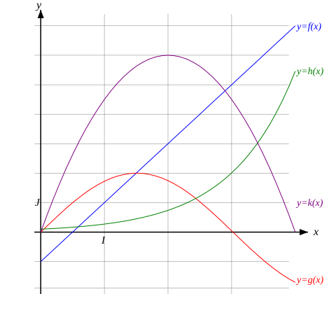
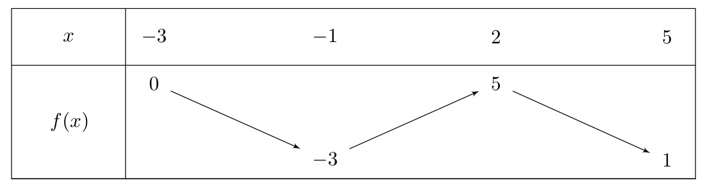

[pdf](./ch05.pdf)

## Exercice 1

Soit la fonction $f(x) = 2x + 3$. Déterminez par lecture graphique le sens de variation de $f$.

## Exercice 2

Soit la fonction $g(x) = -x^2 + 4x - 1$. Construire, par lecture graphique, le tableau de variations de $g$.

## Exercice 3

La fonction $h$ est définie sur $[1; 5]$ par $h(x) = x^3 - 3x + 1$.

Est-elle croissante sur son intervalle de définition ?

## Exercice 4

Pour la fonction $f(x) = x^2 - 4x + 3$ définie sur $[0; 5]$, trouvez les coordonnées du minimum de $f$.

## Exercice 5

Soit la fonction $g(x) = -2x + 5$. $g$ admet-elle un minimum sur $\mathbb{R}$ ?

## Exercice 6

Pour la fonction $f(x) = x^2 - 2x + 1$, trouvez les coordonnées du minimum de $f$.

## Exercice 7

Déterminez les valeurs de $x$ pour lesquelles la fonction $f(x) = x^3 - 6x^2 + 9x$ atteint un maximum ou un minimum.

## Exercice 8

Représentez graphiquement la fonction $g(x) = -x^2 + 4x - 3$ et trouvez les coordonnées du maximum.

## Exercice 9

Soit la fonction $f(x) = 3x - x^3$. Construire son tableau de variation $f$.

## Exercice 10

On considère la fonction $f$ définie sur $\mathbb{R}$ par $f(x)=x^2+2x-3$

1. Construire son tableau de variations par lecture graphique.
2. En vous aidant du tableau précédent, comparer ($<, =, >$) les images suivantes _sans les calculer_ :

    a. $f(3)$ et $f(5)$

    b. $f(-3)$ et $f(-1)$

    c. $f(-1)$ et $f(1)$

    d. $f(7213)$ et $f(9827)$

## Exercice 11

On considère les fonctions $f$, $g$, $h$ et $k$ définies sur $[0;4]$ et dont les représentations sont tracées ci-dessous :

1. Construire les tableaux de variations des fonctions $f$, $g$, $h$ et $k$.
2. Déterminer les maxima de $g$ et de $k$ sur $[0;4]$
3. Vrai/Faux :

    a. $h(2) < h(3)$
 
    b. $2 < 3$ donc $g(2) < g(3)$
    
    c. $k$ est croissante sur $[0;2]$

## Exercice 12 

On considère la fonction  $f$ dont on ne connait que le tableau de variations ci-dessous :

 

1. Énoncer les extrema de $f$.
1. En justifiant à l'aide du tableau, comparer, lorsque c'est possible :
    
    a. $f(1)$ et $f(2)$
    
    b. $f(3)$ et $f(4)$
    
    c. $f(-2)$ et $f(1)$

1. Donner un encadrement de $f(x)$ lorsque :

    a. $x \in [-1;2]$
    
    b. $x \in [-3; 2]$
    
    c. $x \in [2; 5]$

1. Construire une représentation graphique possible pour $f$.
